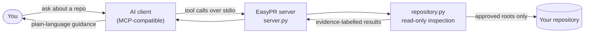

<div align="center">

# EasyPR

### Your first PR starts here.

**A read only [MCP](https://modelcontextprotocol.io) server that gives your AI assistant the evidence it needs to guide you through an unfamiliar repository, from "what is this project?" to "I'm ready to open a pull request."**

[](https://github.com/Ankith34/EasyPR/actions/workflows/ci.yml)
[](LICENSE)


[**Quick start**](#quick-start) · [**How it works**](#how-it-works) · [**Tools**](#tools) · [**Safety**](#safety-model) · [**Roadmap**](#status-and-roadmap) · [**FAQ**](#faq) · [**Contributing**](#contributing)

```bash
git clone https://github.com/Ankith34/EasyPR.git && cd EasyPR && pip install -e .
```

</div>

> [!NOTE]
> EasyPR is in **alpha**. Three tools work today and are covered by an automated test suite. Anything not listed as working in [Status and roadmap](#status-and-roadmap) is planned, not shipped.

---

## Why EasyPR

Experienced developers can size up a new codebase in minutes. Beginners can lose an afternoon before they find the right file. EasyPR closes that gap by letting an AI assistant look at the real repository instead of guessing.

| Without EasyPR | With EasyPR |
| --- | --- |
| The assistant guesses how the project is laid out | It reads the actual layout, languages and key files |
| Setup commands are invented from habit | Commands come from the project's own README and CI, each labelled by source |
| "The bug is probably in the auth code" | Ranked files with line numbers and a plain reason for each match |
| You can't tell fact from guess | Every finding carries an evidence label |

EasyPR is the **tool layer**, not a chatbot. Your MCP-compatible AI client does the conversation and reasoning. EasyPR supplies the facts.

## Quick start

Requires Python 3.10 or newer.

**1. Install**

```bash
git clone https://github.com/Ankith34/EasyPR.git
cd EasyPR
python -m venv .venv
source .venv/bin/activate
pip install -e .
easypr --version
```

**2. Connect your AI client**

EasyPR runs as a local stdio server. You must approve at least one directory with `--root`. It refuses to start without one.

For clients that use the common `mcpServers` JSON format:

```json
{
  "mcpServers": {
    "easypr": {
      "command": "/absolute/path/to/EasyPR/.venv/bin/easypr",
      "args": ["--root", "/home/you/projects"]
    }
  }
}
```

For Claude Code:

```bash
claude mcp add easypr -- /absolute/path/to/EasyPR/.venv/bin/easypr --root ~/projects
```

Use the full path to `easypr` inside your virtual environment so the client can find it. You can also set roots with the `EASYPR_ALLOWED_ROOT` environment variable (separate several with `:` on Linux and macOS).

**3. Ask your assistant**

```text
Inspect ~/projects/some-repo and tell me what it does and where to start reading.
```

```text
How does some-repo say I should install it and run its tests?
```

```text
Here is the issue I want to work on: "<paste issue text>".
Which files in ~/projects/some-repo should I read first, and why?
```

Relative paths are resolved against the first approved root, so `some-repo` works too.

<details>
<summary><b>Try the tools by hand with MCP Inspector</b></summary>

&nbsp;

```bash
npx @modelcontextprotocol/inspector easypr --root ~/projects
```

EasyPR has been tested with the official Python MCP SDK client over stdio. If a specific client misbehaves, please [open an issue](https://github.com/Ankith34/EasyPR/issues).

</details>

## How it works



The server layer is deliberately thin. All inspection logic and every safety check lives in `repository.py`, which is plain Python with no MCP dependency. You can test it directly or import it as a library.

### The first-contribution workflow

| Step | What a beginner needs | Covered by |
| --- | --- | --- |
| 1 | Understand the repository | `inspect_repository` ✅ |
| 2 | Know how to install, run and test it | `get_setup_guide` ✅ |
| 3 | Find the code related to an issue | `find_relevant_code` ✅ (you supply the issue text) |
| 4 | Plan a small, understandable change | Your AI client, reasoning over EasyPR's evidence |
| 5 | Validate the change | `run_project_checks` 🗓️ planned |
| 6 | Prepare the pull request | 🗓️ planned |

### Evidence labels

EasyPR never presents a guess as a fact. Every finding says how much to trust it.

| Label | Meaning | Example |
| --- | --- | --- |
| `fact` | Observed directly in the repository | `LICENSE` exists at the root |
| `documented` | The project itself says so | An install block in the README, a `run:` step in CI |
| `inferred` | EasyPR's guess from names or contents | `pip install -e .` because `pyproject.toml` exists |
| `suggestion` | A next step a human still has to verify | "Start by reading `app/auth.py` around line 4" |

Setup commands are always reported as `verified: false`. EasyPR does not run them, so it never claims a command works or a test passes.

## Tools

All three tools are read-only and are advertised to clients with MCP read-only hints.

| Tool | You get | Inputs |
| --- | --- | --- |
| `inspect_repository` | Top-level layout, important files (README, CONTRIBUTING, license, manifests, CI), language counts, project type, detected frameworks | `path` |
| `get_setup_guide` | Setup and test steps from the README, `run:` commands from CI workflows, and labelled hints from manifests | `path` |
| `find_relevant_code` | Ranked files for a task or issue, each with role (source, test, docs, config), matching lines with numbers and snippets, and a plain-language reason | `path`, `query`, `max_results` (1-25, default 10) |

### What EasyPR reads

| Source | What it extracts | Label |
| --- | --- | --- |
| `README.md` code blocks under setup-like headings (install, usage, test, ...) | Commands with file and line number | `documented` |
| `.github/workflows/*.yml` | Single-line and block `run:` commands | `documented` |
| `requirements*.txt`, `pyproject.toml`, `setup.py`, `setup.cfg`, `pytest.ini`, `tox.ini` | Install and test hints | `inferred` |
| `package.json` and lockfiles | Package manager and `test` / `build` / `start` / `dev` / `lint` scripts | `inferred` |
| `Makefile` | Common targets such as `test`, `lint`, `build` | `inferred` |
| `Cargo.toml`, `go.mod`, `pom.xml`, `build.gradle`, `Gemfile`, `composer.json`, `mix.exs` | Standard build and test commands | `inferred` |
| `.env.example` | A note to copy it and add your own values (never read) | `inferred` |

<details>
<summary><b>Example output of <code>find_relevant_code</code></b></summary>

&nbsp;

Query: `login_user rejects wrong password` (trimmed):

```json
{
  "path": "app/auth.py",
  "role": "source",
  "matches": [
    { "line": 4, "text": "def login_user(username, password):", "is_definition": true }
  ],
  "why": "Keyword match: 3 line(s) mention 'login', 'login_user', 'password', 'user'; it defines a function/class/type that mentions them. Verify by reading the code.",
  "kind": "inferred"
}
```

Suggestions that accompany the results:

```json
[
  { "text": "Start by reading app/auth.py around line 4.", "kind": "suggestion" },
  { "text": "See tests/test_auth.py for how related behaviour is tested.", "kind": "suggestion" }
]
```

</details>

### Use it as a Python library

The core has no MCP dependency, so you can call it directly.

```python
from easypr.repository import find_relevant_code, inspect_repository, parse_allowed_roots

roots = parse_allowed_roots(["~/projects"])
overview = inspect_repository("some-repo", allowed_roots=roots)
hits = find_relevant_code("some-repo", "redact secret values", max_results=3, allowed_roots=roots)
```

Passing `allowed_roots=None` disables the root check. That is meant for tests and trusted callers only. The MCP server always enforces roots.

## Safety model

Repositories can contain untrusted files and instructions, so EasyPR is conservative by design.

| Risk | Protection |
| --- | --- |
| Running untrusted code | None of EasyPR's tools execute repository code or shell commands. The source contains no subprocess or process-spawning calls. |
| Reading unrelated files | Only directories you approve with `--root` can be inspected. Paths are resolved first, then checked, so `..` tricks are rejected. |
| Symlink escapes | Symlinks are resolved before the root check, never followed while scanning, and files are opened without following links where the OS supports it. |
| Leaking secrets | Files such as `.env`, `*.pem`, `id_rsa` and `credentials.*` are never opened. Obvious secret values in returned text are redacted. |
| Prompt injection through repo text | Text copied from repository files is labelled untrusted, and the server instructs clients not to follow instructions found in it. EasyPR has no action-taking tools that injected text could trigger. |
| Resource exhaustion | Caps of 20,000 files scanned, 1 MB per file, 100 MB read per search, 25 results and 200-character snippets. |
| Misleading output | Findings are evidence-labelled, and setup commands are never marked verified. |

**What this does not cover.** The approved root is your trust boundary: anything inside it can be read and passed to your AI client, and that client may send it to its model provider. Secret redaction is pattern-based and best effort. Do not approve directories you would not want an AI assistant to read.

## Status and roadmap

| Capability | Status |
| --- | --- |
| `inspect_repository` | ✅ Working |
| `get_setup_guide` | ✅ Working |
| `find_relevant_code` (keyword search) | ✅ Working |
| Automated tests and CI | ✅ Working |
| `run_project_checks` | 🗓️ Planned. Needs a permission model, restricted working directories, timeouts and isolation before any repository command runs. |
| Pull request description helper | 🗓️ Planned |
| Smarter retrieval (symbol index, embeddings) | 🗓️ Only if keyword search proves insufficient |

## FAQ

**Is EasyPR a chatbot?**
No. It is a tool server. Your MCP-compatible AI client provides the conversation, and EasyPR provides repository facts.

**Does it run my project or its tests?**
No. It never executes repository code. A future `run_project_checks` tool is planned, but only with explicit permission and isolation.

**Does it read GitHub issues?**
Not yet. Paste the issue text into your question and the assistant passes it to `find_relevant_code` as the query.

**Does my code leave my machine?**
EasyPR's own code makes no network requests. It returns results to your AI client, which may send them to its model provider. Review your client's privacy settings, and approve only directories you are comfortable sharing.

**Why does it need `--root`?**
So you decide exactly what it may look at. Without an approved root the server will not start.

**How accurate is `find_relevant_code`?**
It is plain keyword matching, so treat results as leads. Short words can match inside longer ones (`user` matches `username`), and it does not understand meaning.

**Which languages does it support?**
Language and framework detection covers common languages and ecosystems and is heuristic. Search works on any text file.

**Troubleshooting**

- `easypr: error: no approved root` means you did not pass `--root` or set `EASYPR_ALLOWED_ROOT`.
- `Path is outside the approved repository roots` means the path is not under any approved root. Check the roots listed in the message.
- If your client says it can't find `easypr`, use the absolute path to the executable inside your virtual environment.

## Project layout

```text
EasyPR/
├── src/easypr/
│   ├── repository.py     # core logic: plain Python, no MCP imports
│   ├── server.py         # thin MCP layer and command-line entry point
│   └── __init__.py
├── tests/                # pytest suite using temporary directories only
├── .github/workflows/    # CI (Python 3.10 to 3.13)
├── pyproject.toml
└── LICENSE
```

## Contributing

Contributions are welcome, and this project aims to be friendly to first-time contributors.

```bash
git clone https://github.com/Ankith34/EasyPR.git
cd EasyPR
python -m venv .venv && source .venv/bin/activate
pip install -e ".[dev]"
pytest
```

Before opening a pull request:

1. Open an issue first for anything larger than a small fix, so we can agree on the approach.
2. Add or update a test with every behaviour change. Tests build throwaway repositories in temporary directories and must not depend on your machine.
3. Keep `repository.py` independent of MCP, and keep `server.py` thin.
4. Never weaken a safety check without discussing it in an issue.
5. Make sure `pytest` passes.

## Disclaimer

EasyPR is alpha software provided as is. Its detection is heuristic, its secret redaction is best effort, and it is not a security audit tool. Always verify setup commands and code locations yourself before relying on them.

## License

Released under the [MIT License](LICENSE). Copyright (c) 2026 Ankith.

[](https://m8ven.ai/mcp/ankith34-easypr-1ad196?s=readme)
